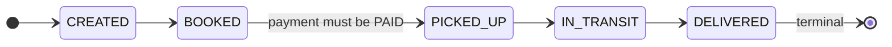
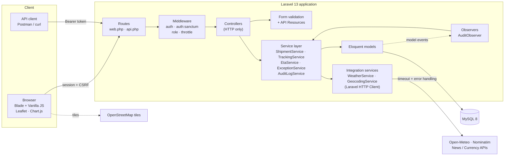

<div align="center">

# 🚢 CargoTrace

### Global Shipment Visibility & Tracking Platform

*Where is my shipment? Is it late? What went wrong?*

[](https://cargotrace-4ljr.ethiodeploy.app/)


**[🌐 Live Application](https://cargotrace-4ljr.ethiodeploy.app/)** · **[📦 GitHub Repository](https://github.com/ulfialuv/CargoTrace)** · **[🗄️ ERD](#database-design)** · **[🏗️ Architecture](#system-architecture)** · **[📮 Postman Collection](docs/CargoTrace.postman_collection.json)**

<br>


</div>

---

> **Web Programming 2 — Final Project (UAS)** · Individual submission
>
> | | |
> |---|---|
> | **Name** | Ulfia Rahmi |
> | **Student ID (NIM)** | 250180023 |
> | **Study Program** | Information Systems (Sistem Informasi) |
> | **Faculty** | Engineering (Teknik) |
> | **University** | Universitas Malikussaleh |
> | **Lecturer** | Muhammad Ikhwani, S.Pd.I., M.Sc |

---

## Table of Contents

- [Project Overview](#project-overview)
- [Problem Statement](#problem-statement)
- [Try It Online](#try-it-online)
- [Key Features](#key-features)
- [User Roles](#user-roles)
- [Screenshots](#screenshots)
- [Business Rules](#business-rules)
  - [Shipment Lifecycle](#shipment-lifecycle)
  - [ETA & Delay Rule](#eta--delay-rule)
  - [Exception Management](#exception-management)
- [System Architecture](#system-architecture)
- [Database Design](#database-design)
  - [ERD](#erd)
  - [Cardinality & Design Decisions](#cardinality--design-decisions)
  - [Data Dictionary](#data-dictionary)
- [Tech Stack](#tech-stack)
- [REST API](#rest-api)
- [External Integrations](#external-integrations)
- [Security](#security)
- [Testing](#testing)
- [Getting Started (Local Setup)](#getting-started-local-setup)
- [Deployment](#deployment)
- [Project Structure](#project-structure)
- [Known Limitations & Future Work](#known-limitations--future-work)
- [Attribution](#attribution)
- [Author](#author)

---

## Project Overview

**CargoTrace** is a web-based shipment visibility and logistics management platform built with **Laravel**. It helps logistics operators manage shipments, tracking activities, delay detection and delivery exceptions in one integrated application, while giving customers a clear view of their own shipment progress.

- **Operators** record tracking events, move shipments through their lifecycle and handle exceptions.
- **Administrators** manage users, carriers, facilities (locations), monitor the whole operation and review the audit log.
- **Customers** follow only *their own* shipments on a timeline and a map, with ETA, delay information and notifications.

> All demo data is synthetic but kept consistent and realistic (Indonesian ports, airports and warehouses; sea, air and road carriers).

## Problem Statement

| Problem | How CargoTrace addresses it |
|---|---|
| Shipment information is scattered and hard to monitor. | A single place to manage shipments, carriers, facilities and tracking events. |
| Customers do not know the latest status and travel history. | Per-customer shipment list with status, ETA, chronological timeline and route map. |
| Delays and exceptions are not visible centrally. | A deterministic, configurable delay rule plus an exception workflow (`OPEN → INVESTIGATING → RESOLVED`). |
| Operators need a dashboard to prioritise follow-up. | Dashboards built from live database data: counts, charts, delayed shipments and open exceptions. |

## Try It Online

🔗 **https://cargotrace-4ljr.ethiodeploy.app/**

| Role | Email | Password |
|---|---|---|
| **Administrator** | `admin@cargotrace.com` | `password` |
| **Logistics Operator** | `operator1@cargotrace.test` | `password` |
| **Customer** | *Create your own account with **"Buat akun"** (register) on the login page.* | — |

> 💡 The user interface is in **Indonesian** (the target users are Indonesian logistics staff and customers); the code, API and this documentation are in English.
> New accounts created through the public registration form are always **customers** — it is not possible to self-register as admin or operator.

**Suggested 5-minute walkthrough**

1. Log in as **operator** → open *Pengiriman* (Shipments) → create a shipment or open a seeded one.
2. Add a **tracking event** and move the status to the next step (`BOOKED → PICKED_UP → …`). Try skipping a step: the backend rejects it with a validation error.
3. Open *Pelacakan* (Tracking) to see the **timeline and the Leaflet map**.
4. Open a shipment whose ETA is later than its promised date to see the **delay severity and reason**, and the automatically created `[AUTO-DELAY]` exception.
5. Log in as **admin** → *Dashboard*, *Audit Log*, carriers, facilities and users.
6. Register a **customer** account and confirm you can only see your own shipments.

---

## Key Features

| Area | What it does |
|---|---|
| 🔐 **Authentication & RBAC** | Session login for the web UI, **Laravel Sanctum** bearer tokens for the API. Three roles (`admin`, `operator`, `customer`) enforced **on the server** by middleware and per-user data scoping — not just by hiding buttons. |
| 📦 **Shipment lifecycle** | `CREATED → BOOKED → PICKED_UP → IN_TRANSIT → DELIVERED`. Only the *next* status is accepted, `DELIVERED` is terminal, and pickup is gated by payment. Every transition is logged. |
| 🧭 **Tracking & timeline** | Historical, append-only tracking events (status, location, latitude/longitude, time, description, author). Chronological timeline; current location is derived from the latest event. |
| 🗺️ **Map** | Leaflet.js + OpenStreetMap showing origin, destination and tracking points with popups (status, time, location). |
| ⏱️ **ETA & delay** | Compares the current ETA (`estimated_arrival`) with the promised date (`expected_arrival`). Shows delay duration, severity and the exact values/reason used. Threshold and bands are configurable. |
| ⚠️ **Exception management** | Six exception types, three severities, `OPEN / INVESTIGATING / RESOLVED` workflow, detection and resolution time, assignee, and a full change history. Delays create/close an exception automatically. |
| 📊 **Dashboard** | Totals, in-transit / delivered / delayed counts, open exceptions, shipments by status and by carrier (Chart.js) — all computed from the database. |
| 🔍 **Search & filter** | Shipment number search, status / carrier / origin / destination filters, date range and **server-side pagination**. |
| 🔔 **Notifications** | In-app notifications (read / unread / delete) per role, with per-user preferences for shipment, tracking, delay and exception alerts. |
| 🧾 **Audit log** | Who did what, when and to which record — with old/new values, IP address and user agent. Covers shipments, exceptions, carriers, facilities, users, status changes and login/logout. Admin only. Passwords are never stored. |
| 🌐 **External APIs** | Weather (Open-Meteo), geocoding (Nominatim), news, currency and world-time tools, all with timeout and error handling. |
| 👤 **Customer profile** | Profile, password change, notification preferences and an address book with a primary address. |
| 🚀 **DevOps** | Docker image (PHP 8.4 + Apache), auto-migration on start, health check endpoint `/up`, Postman collection, PHPUnit test suite. |

## User Roles

| Capability | Admin | Operator | Customer |
|---|:-:|:-:|:-:|
| Manage users | ✅ | – | – |
| Manage carriers & facilities (locations) | ✅ | – | – |
| View audit log | ✅ | – | – |
| Create / edit shipments | ✅ | ✅ | – |
| Record tracking events & change status | ✅ | ✅ | – |
| Report and update exceptions | ✅ | ✅ | – |
| Delete shipments | ✅ | – | – |
| View shipments, tracking, exceptions | all | all | **own only** |
| Map, ETA, delay information | ✅ | ✅ | ✅ (own) |
| Notifications | ✅ | ✅ | ✅ |
| Manage own profile & addresses | – | – | ✅ |

Route groups are protected by `role:admin`, `role:operator` and `role:customer` middleware (`RoleMiddleware`), and API controllers additionally scope customer queries to `user_id`. An unauthorised role receives **403**.

## Screenshots

| Login | Admin dashboard |
|:-:|:-:|
|  |  |

| Shipment list (search & filter) | Shipment detail: timeline & map |
|:-:|:-:|
|  |  |

| Operator: update status & tracking | Exception management |
|:-:|:-:|
|  |  |

| Customer dashboard | Audit log |
|:-:|:-:|
|  |  |

---

## Business Rules

### Shipment Lifecycle



- Transitions are validated in the **backend** (`TrackingService::transition`) inside a database transaction with a row lock (`lockForUpdate`), so two operators cannot push conflicting updates.
- Skipping or reversing a status returns **HTTP 422** with a clear message (e.g. `Transisi tidak valid: CREATED → IN_TRANSIT. Status berikutnya yang diizinkan hanya BOOKED.`).
- `DELIVERED` is **terminal** and can never be changed.
- Moving to `PICKED_UP` requires a `PAID` payment record (a simulated invoice — no real payment gateway is integrated).
- Tracking events are **historical**: adding a new event never overwrites old ones, and each status change is also written to `shipment_status_logs`.

### ETA & Delay Rule

The rule is deterministic and unit-tested (`EtaService`):

```
delay    = estimated_arrival (current ETA) − expected_arrival (promised date)
delayed  = delay > CARGOTRACE_DELAY_THRESHOLD_HOURS

severity = LOW      if delay ≤ 6 h
           MEDIUM   if 6 h < delay ≤ 24 h
           HIGH     if delay > 24 h
```

| Delay | Severity |
|---|---|
| 0 – 6 hours | 🟢 LOW |
| > 6 – 24 hours | 🟠 MEDIUM |
| > 24 hours | 🔴 HIGH |

- Differences are computed in **whole minutes**.
- Every shipment returned by the API includes a `delay` object containing the values used and a plain-language **reason**.
- When a shipment becomes delayed, an `[AUTO-DELAY]` exception is created; it is updated if the severity changes and **closed automatically** when the shipment is back on time or delivered.
- Weather data is displayed as **context only** — it is never used to predict or explain delay.

The threshold and bands are **configurable** without touching the code (`config/cargotrace.php`, via `.env`):

```env
CARGOTRACE_DELAY_THRESHOLD_HOURS=12     # delay must exceed this to count as DELAYED
CARGOTRACE_DELAY_LOW_MAX_HOURS=6
CARGOTRACE_DELAY_MEDIUM_MAX_HOURS=24
CARGOTRACE_DELAY_EXCEPTION_TYPE=PORT_CONGESTION
```

Run `php artisan config:clear` after changing these values.

### Exception Management

| Item | Values |
|---|---|
| **Types** | `CUSTOMS_HOLD`, `WEATHER_DELAY`, `PORT_CONGESTION`, `DAMAGED`, `MISROUTED`, `DOCUMENTATION_ISSUE` |
| **Severity** | `LOW`, `MEDIUM`, `HIGH` |
| **Status** | `OPEN` → `INVESTIGATING` → `RESOLVED` |
| **Recorded** | detection time (`occurred_at`), resolution time (`resolved_at`), cause, impact, reporter, assignee, attachment path |
| **History** | every change is stored in `exception_histories` (action, old/new status, note, user) |

---

## System Architecture

HTTP handling is separated from business logic: controllers stay thin and delegate rules and transactions to a **service layer**.



| Layer | Responsibility |
|---|---|
| **Routes + Middleware** | Authentication (`auth`, `auth:sanctum`), role authorisation (`role:`), throttling. |
| **Controllers** | Validate input, call a service, shape the response (Blade view or JSON envelope). |
| **Services** | Business rules, status transitions, ETA/delay calculation, exception lifecycle, database transactions. |
| **Observers** | `AuditObserver` writes audit entries when models are created/updated/deleted. |
| **Models (Eloquent)** | Relationships, casts, mass-assignment protection via `$fillable`. |
| **Integration services** | Call external APIs through the Laravel HTTP Client with timeouts, caching and graceful fallbacks. |

| Service | Responsibility |
|---|---|
| `ShipmentService` | Create / update / delete rules, shipment number generation. |
| `TrackingService` | Status transition rules, tracking events, payment gate, status logs. |
| `EtaService` | ETA vs. expected-arrival rule, severity classification, human-readable reason. |
| `ExceptionService` | Exception lifecycle with history; automatic delay exceptions. |
| `AuditLogService` | Writes audit entries (used by `AuditObserver` and login/logout listeners). |
| `WeatherService` | Open-Meteo current weather (10-minute cache). |
| `GeocodingService` | Nominatim place search (24-hour cache). |

> The REST API controllers (`app/Http/Controllers/Api`) use these services directly. Some older web controllers still hold part of their own logic — see [Known Limitations](#known-limitations--future-work).

---

## Database Design

### ERD

> An editable **draw.io** version is available at [`docs/erd.drawio`](docs/erd.drawio).

<p align="center">
  
</p>

> Framework tables (`sessions`, `cache`, `cache_locks`, `jobs`, `job_batches`, `failed_jobs`, `password_reset_tokens`) are omitted from the diagram.

### Cardinality & Design Decisions

| Relationship | Cardinality | Rule / reason |
|---|---|---|
| `users` → `shipments` | 1 : N | A customer owns many shipments. FK is **nullable with `SET NULL`** so shipment history survives account removal. Customer access is scoped by `user_id`. |
| `shipments` → `shipment_tracking` | 1 : N | Timeline of events. **`CASCADE`** delete; composite index `(shipment_id, event_time)` for fast ordered timelines. Events are append-only to keep history. |
| `shipments` → `shipment_exceptions` | 1 : N | A shipment can have several exceptions over time. **`CASCADE`** delete. Indexes on `(status, severity)` and `(type, occurred_at)` for dashboard filters. |
| `shipment_exceptions` → `exception_histories` | 1 : N | Full audit trail of every exception change. **`CASCADE`** delete. |
| `users` → `shipment_exceptions` | 1 : N (×2) | Two nullable FKs: `reported_by` and `assigned_to` (`SET NULL`). |
| `users` → `customer_addresses` | 1 : N | Address book; exactly one row may be `is_primary` per user. |
| `users` → `audit_logs` | 1 : N | `user_id` is `SET NULL`, and the actor's name, e-mail and role are **copied into the row** so history stays readable after a user is deleted. |
| `shipments` → `shipment_payments` / `shipment_status_logs` | 1 : N | Linked by an indexed `shipment_id`, intentionally without a database-level FK so payment/log history is never lost by a cascade. |
| `carriers`, `facilities` ↔ `shipments` | logical | Shipments store the carrier **name** and origin/destination **name** as text snapshots, so editing master data never rewrites historical shipments. |

**Other decisions**

- **Unique constraints:** `users.email`, `shipments.shipment_number`, `carriers.code`, `facilities.facility_code`, `shipment_payments.invoice_number`, `personal_access_tokens.token`.
- **Two arrival dates:** `expected_arrival` (the promise to the customer) is never moved; `estimated_arrival` (current ETA) is updated by operators. Their difference *is* the delay.
- **Enums** (`status`, `severity`, `type`) keep invalid values out of the database; business transitions are enforced in the service layer.
- **Coordinates** are stored as `decimal(10,7)` for consistent map rendering.
- **No soft deletes** — deletions are rare and are recorded in the audit log instead.
- **Table mapping to the course brief:** `locations` → `facilities`, `tracking_events` → `shipment_tracking`.

### Data Dictionary

<details>
<summary><b>Click to expand the full data dictionary</b></summary>

#### `users`
| Column | Type | Notes |
|---|---|---|
| id | bigint PK | |
| name | varchar(255) | |
| email | varchar(255) | **unique** |
| password | varchar(255) | bcrypt hash |
| role | varchar(30) | `admin` / `operator` / `customer` (default `customer`) |
| phone, whatsapp_number | varchar(30) | nullable |
| birth_date, gender | date / varchar(20) | nullable |
| address, city, province, postal_code, country | text / varchar | nullable |
| profile_photo_path | varchar(255) | nullable |
| notify_shipment_updates, notify_tracking_updates, notify_delay_alerts, notify_exception_alerts, notify_email | boolean | notification preferences |
| last_login_at, profile_updated_at, password_changed_at | timestamp | nullable |
| remember_token, email_verified_at, created_at, updated_at | — | Laravel defaults |

#### `carriers`
| Column | Type | Notes |
|---|---|---|
| id | bigint PK | |
| name | varchar(255) | |
| code | varchar(255) | **unique** |
| logo | varchar(255) | nullable |
| service_type | varchar(255) | sea / air / road etc. |
| phone, email, address, description | varchar / text | nullable |
| status | enum | `ACTIVE`, `INACTIVE` |

#### `facilities` (locations)
| Column | Type | Notes |
|---|---|---|
| id | bigint PK | |
| facility_code | varchar(50) | **unique** |
| name | varchar(255) | |
| type | enum | `PORT`, `AIRPORT`, `DEPOT`, `WAREHOUSE` |
| address, city, province, country | text / varchar | country defaults to Indonesia |
| latitude, longitude | decimal(10,7) | nullable, used on the map |
| capacity | decimal(12,2) | nullable |
| status | enum | `ACTIVE`, `INACTIVE` |
| description | text | nullable |

Indexes: `(type, status)`, `(city, province)`.

#### `shipments`
| Column | Type | Notes |
|---|---|---|
| id | bigint PK | |
| user_id | bigint FK → users | nullable, `SET NULL` |
| shipment_number | varchar(255) | **unique**, generated (e.g. `CT-2026-001`) |
| customer_name, shipment_name | varchar(255) | |
| cargo_type | varchar(255) | |
| weight | decimal(10,2) | |
| volume | decimal(10,2) | nullable |
| carrier, transport_type | varchar(255) | carrier name; sea / air / road |
| origin, destination | varchar(255) | |
| estimated_departure | datetime | |
| estimated_arrival | datetime | current ETA |
| expected_arrival | datetime | promised date (defaults to initial ETA) |
| status | enum | `CREATED`, `BOOKED`, `PICKED_UP`, `IN_TRANSIT`, `DELIVERED` |
| notes | text | nullable |

#### `shipment_tracking` (tracking events)
| Column | Type | Notes |
|---|---|---|
| id | bigint PK | |
| shipment_id | bigint FK → shipments | `CASCADE` |
| status | varchar(255) | event / status label |
| location | varchar(255) | |
| event_time | datetime | |
| latitude, longitude | decimal(10,7) | nullable |
| description | text | nullable |
| updated_by | varchar(255) | author name |

Index: `(shipment_id, event_time)`.

#### `shipment_exceptions`
| Column | Type | Notes |
|---|---|---|
| id | bigint PK | |
| shipment_id | bigint FK → shipments | `CASCADE` |
| type | varchar(255) | see exception types |
| location | varchar(255) | |
| occurred_at | datetime | detection time |
| severity | enum | `LOW`, `MEDIUM`, `HIGH` |
| status | enum | `OPEN`, `INVESTIGATING`, `RESOLVED` |
| description | text | |
| cause, impact | text | nullable |
| assigned_to, reported_by | bigint FK → users | nullable, `SET NULL` |
| resolved_at | datetime | nullable |
| attachment_path | varchar(255) | nullable |

Indexes: `(status, severity)`, `(type, occurred_at)`.

#### `exception_histories`
| Column | Type | Notes |
|---|---|---|
| id | bigint PK | |
| exception_id | bigint FK → shipment_exceptions | `CASCADE` |
| user_id | bigint FK → users | nullable, `SET NULL` |
| action | varchar(255) | |
| old_status, new_status | varchar(255) | nullable |
| note | text | nullable |

Index: `(exception_id, created_at)`.

#### `shipment_payments`
| Column | Type | Notes |
|---|---|---|
| id | bigint PK | |
| shipment_id | bigint | indexed |
| invoice_number | varchar(40) | **unique** |
| method | varchar(20) | |
| payment_code, gateway_ref, note, created_by | varchar | nullable |
| subtotal, tax, fee, total | bigint | amount in IDR |
| currency | varchar(3) | default `IDR` |
| status | varchar(12) | indexed (e.g. `PAID`) |
| expires_at, paid_at, refunded_at | timestamp | nullable |

#### `shipment_status_logs`
| Column | Type | Notes |
|---|---|---|
| id | bigint PK | |
| shipment_id | bigint | indexed |
| from_status | varchar(20) | nullable |
| to_status | varchar(20) | |
| type | varchar(12) | default `TRANSITION` |
| reason | text | nullable |
| actor | varchar(255) | nullable |

#### `customer_addresses`
| Column | Type | Notes |
|---|---|---|
| id | bigint PK | |
| user_id | bigint FK → users | `CASCADE` |
| label | varchar(100) | default `Alamat Utama` |
| recipient_name, phone | varchar | |
| address | text | |
| city, province, postal_code, country | varchar | |
| is_primary | boolean | index `(user_id, is_primary)` |

#### `audit_logs`
| Column | Type | Notes |
|---|---|---|
| id | bigint PK | |
| user_id | bigint FK → users | nullable, `SET NULL` |
| user_name, user_email, user_role | varchar | copied snapshot of the actor |
| action | varchar(50) | indexed |
| module | varchar(100) | indexed |
| description | varchar(500) | nullable |
| subject_type, subject_id | varchar / bigint | affected record |
| reference_number | varchar(255) | e.g. shipment number |
| old_values, new_values | json | nullable (passwords excluded) |
| ip_address, user_agent | varchar(45) / text | nullable |

#### `notifications`
Laravel database-notification table: `id` (uuid PK), `type`, `notifiable_type` + `notifiable_id` (polymorphic), `data`, `read_at`.

#### `personal_access_tokens`
Laravel Sanctum token table: `tokenable_type` + `tokenable_id` (polymorphic), `name`, `token` (**unique**, hashed), `abilities`, `last_used_at`, `expires_at`.

</details>

---

## Tech Stack

| Layer | Technology |
|---|---|
| **Language / Framework** | PHP 8.4+, **Laravel 13**, Blade templates |
| **Database** | MySQL 8 (Eloquent ORM, migrations, seeders) |
| **API & Auth** | Laravel REST API, **Laravel Sanctum 4** |
| **Frontend** | Blade, custom CSS, vanilla JavaScript (Fetch API) |
| **Map** | **Leaflet.js 1.9.4** + OpenStreetMap tiles |
| **Charts** | **Chart.js** |
| **External services** | Laravel HTTP Client → Open-Meteo, Nominatim, news and currency APIs |
| **Testing** | PHPUnit 12 (Feature + Unit tests, in-memory SQLite) |
| **Tooling** | Composer, Laravel Pint, Postman, Git + GitHub |
| **Deployment** | Docker (PHP 8.4 + Apache), EthioDeploy, external MySQL |

---

## REST API

Base path: `/api` (the same routes are also exposed under `/api/v1`). All responses are JSON. Authenticate with a **Sanctum bearer token**.

```bash
# 1) Log in and copy data.token from the response
curl -X POST https://cargotrace-4ljr.ethiodeploy.app/api/login \
  -H "Accept: application/json" -H "Content-Type: application/json" \
  -d '{"email":"operator1@cargotrace.test","password":"password"}'

# 2) Call a protected endpoint
curl https://cargotrace-4ljr.ethiodeploy.app/api/shipments \
  -H "Accept: application/json" \
  -H "Authorization: Bearer <token>"
```

| Method | Endpoint | Access |
|---|---|---|
| `POST` | `/register`, `/login` | public (register always creates a **customer**) |
| `POST` / `GET` | `/logout`, `/user` | any logged-in user |
| `GET` | `/shipments`, `/shipments/{id}` | all roles (customer: **own only**) |
| `POST` | `/shipments` | admin, operator |
| `PUT` / `PATCH` | `/shipments/{id}` | admin, operator |
| `PATCH` | `/shipments/{id}/status` | admin, operator |
| `DELETE` | `/shipments/{id}` | admin |
| `GET` / `POST` | `/shipments/{id}/tracking` | read: all (own only) · write: admin, operator |
| `GET` / `POST` | `/shipments/{id}/exceptions` | read: all (own only) · write: admin, operator |
| `GET` | `/exceptions`, `/exceptions/{id}` | all roles (customer: own only) |
| `POST` | `/exceptions` | admin, operator |
| `PUT` / `PATCH` | `/exceptions/{id}` | admin, operator |
| `GET` | `/carriers`, `/locations` (+ `/{id}`) | all roles |
| `POST` / `PUT` / `DELETE` | `/carriers`, `/locations` | admin |
| `GET` | `/geocode`, `/weather` | any logged-in user (rate limited) |

**Filtering & pagination:** `?page=`, `?per_page=` (max 50), `?status=`, `?search=` and more per resource.

**Consistent response envelope**

```json
{ "success": true,  "message": "OK", "data": { }, "meta": { "current_page": 1, "per_page": 15, "total": 42, "last_page": 3 } }
{ "success": false, "message": "Data yang dikirim tidak valid.", "errors": { "status": ["..."] } }
```

| Code | Meaning |
|---|---|
| `200` / `201` | success / created |
| `401` | missing or invalid token |
| `403` | role not allowed, or someone else's data |
| `404` | resource not found |
| `409` | conflict (e.g. deleting a paid shipment or a carrier in use) |
| `422` | validation error or invalid status transition |
| `429` | rate limited |

Error responses never leak stack traces. A ready-to-use **Postman collection** is included: [`docs/CargoTrace.postman_collection.json`](docs/CargoTrace.postman_collection.json) — import it, set the `base_url` variable and run **Auth → Login** first.

---

## External Integrations

All integrations use the **Laravel HTTP Client** with explicit timeouts, response caching where useful, and graceful handling of timeouts, error responses and empty data — a failing third-party service never breaks the page.

| Integration | Provider | Used for | Key required |
|---|---|---|---|
| **Weather** | [Open-Meteo](https://open-meteo.com/) | Current weather context for a location (10-min cache). *Context only — not a delay predictor.* | No |
| **Geocoding** | [Nominatim / OpenStreetMap](https://nominatim.org/) | Convert a place name to coordinates (24-h cache, identifying `User-Agent`). | No |
| **Map tiles** | [OpenStreetMap](https://www.openstreetmap.org/copyright) via Leaflet | Shipment route map. | No |
| **Currency** | [open.er-api.com](https://www.exchangerate-api.com/docs/free) | Currency converter tool for admin. | No |
| **News** | GNews / public RSS | Logistics news feed for admin (optional). | Optional (`GNEWS_API_KEY`) |

API keys live **only** in environment variables and are never committed.

---

## Security

- **Password hashing** (bcrypt) and Laravel `auth` / `auth:sanctum` middleware on every protected route.
- **Server-side authorisation:** `role:` middleware on route groups **plus** per-user scoping of queries (a customer cannot read another customer's shipment, even by guessing the ID — verified by automated tests).
- **Validation:** form-request / controller validation on all inputs; enum and transition checks in services.
- **CSRF** protection on web forms, **XSS** protection through Blade escaping, **SQL injection** prevention through Eloquent / query-builder bindings.
- **Mass-assignment protection** with explicit `$fillable` on every model.
- **Rate limiting:** web login (5 attempts/min), API login/register (10/min), API (120/min), external tools (30/min).
- **Registration** can only create the `customer` role.
- **Consistent error handling:** API errors use a JSON envelope without stack traces; `APP_DEBUG=false` in production.
- **Secrets:** `.env` is git-ignored; only `.env.example` is committed. Demo seeding refuses to run in production unless explicitly allowed (`DEMO_ALLOW_PRODUCTION`).
- **Audit log** for important changes, including login/logout.

---

## Testing

```bash
php artisan test
# or
composer test
```

The suite contains **111 automated tests** (Feature + Unit) and runs on an **in-memory SQLite** database (enable the `pdo_sqlite` PHP extension), so your MySQL data is never touched.

| Test class | Focus |
|---|---|
| `AuthApiTest` | valid / invalid login, register, access without a token |
| `ShipmentApiTest` | CRUD, validation, role and ownership authorisation, filters |
| `TrackingApiTest`, `Unit/TrackingServiceTest` | tracking events, **invalid status transitions**, terminal status |
| `EtaServiceTest` (Unit), `DelayAndExceptionApiTest` | ETA/delay rule, severity boundaries, thresholds, automatic delay exceptions |
| `ExceptionApiTest` | exception lifecycle and history |
| `MasterDataApiTest` | carriers & locations (admin-only writes) |
| `RoleAccessWebTest` | web route restrictions per role |
| `AuditLogTest` | audit entries, admin-only access, password never logged |
| `ExternalDataApiTest` | weather / geocoding success, timeout, error and empty responses |
| `DashboardIncomeTest`, `DemoSeederTest` | dashboard numbers from real data; seeder consistency |

---

## Getting Started (Local Setup)

**Requirements:** PHP **8.4+**, Composer, MySQL 8, and the PHP extensions `pdo_mysql`, `mbstring`, `openssl`, `bcmath`, `zip` (and `pdo_sqlite` to run the tests). With [Laragon](https://laragon.org) these are included.

```bash
# 1. Clone
git clone https://github.com/ulfialuv/CargoTrace.git
cd CargoTrace

# 2. Install dependencies and configure
composer install
cp .env.example .env          # Windows: copy .env.example .env
php artisan key:generate
```

Create an **empty MySQL database** named `cargotrace` (or change `DB_*` in `.env`), then:

```bash
# 3. Create tables and demo data
php artisan migrate
php artisan db:seed           # demo accounts, carriers, facilities, shipments, tracking events, exceptions

# 4. Run
php artisan serve             # http://127.0.0.1:8000
```

### Demo data & accounts (local)

`php artisan db:seed` is safe to run repeatedly: it never overwrites an existing account's password and only recreates the `CT-DEMO-xxx` shipments. It does nothing when `APP_ENV=production` (unless `DEMO_ALLOW_PRODUCTION=true`).

| Role | Email | Password |
|---|---|---|
| Admin | `admin@cargotrace.com` | `DEMO_PASSWORD` in `.env` (default `password`) |
| Operator | `operator1@cargotrace.test`, `operator2@cargotrace.test` | same |
| Customer | `customer1@cargotrace.test` … `customer3@cargotrace.test` | same |

The seeded data covers **every lifecycle status**, shipments delayed at **LOW / MEDIUM / HIGH** severity, **open / investigating / resolved** exceptions, and an on-time delivery, so every screen has something to show.

### Useful commands

```bash
php artisan test                 # run the automated tests
php artisan config:clear         # after editing .env
php artisan migrate:fresh --seed # rebuild the database with demo data
./vendor/bin/pint                # code style
```

---

## Deployment

CargoTrace ships as a single **Docker image** (`Dockerfile`: PHP 8.4 + Apache) and is deployed on **EthioDeploy** with an external **MySQL** database.
👉 Live: **https://cargotrace-4ljr.ethiodeploy.app/** · Health check: `/up`

On every container start, `docker-entrypoint.sh`:

1. makes Apache listen on the platform's `PORT`;
2. stops with a clear message if `APP_KEY` or the database settings are missing;
3. caches configuration, routes and views;
4. runs `php artisan migrate --force` (retried 5 times while the database wakes up);
5. optionally seeds demo data when `RUN_SEED=true`;
6. starts Apache.

**Key environment variables** (set in the hosting dashboard — never commit them):

| Variable | Example / note |
|---|---|
| `APP_KEY` | required — `php artisan key:generate --show` |
| `APP_ENV`, `APP_DEBUG` | `production`, `false` |
| `APP_URL` | public HTTPS URL |
| `TRUSTED_PROXIES` | `*` (HTTPS is terminated by the platform proxy) |
| `DB_CONNECTION`, `DB_HOST`, `DB_PORT`, `DB_DATABASE`, `DB_USERNAME`, `DB_PASSWORD` | MySQL credentials (or `DATABASE_URL`, mapped to `DB_URL` automatically) |
| `LOG_CHANNEL` | `stderr` |
| `SESSION_DRIVER`, `CACHE_STORE`, `QUEUE_CONNECTION` | `file`, `file`, `sync` |
| `CARGOTRACE_DELAY_THRESHOLD_HOURS` | delay threshold in hours |
| `RUN_SEED`, `DEMO_ALLOW_PRODUCTION`, `DEMO_PASSWORD` | demo data for the first deploy |

The complete guide, checklist and troubleshooting table are in [`docs/DEPLOYMENT.md`](docs/DEPLOYMENT.md).

---

## Project Structure

```
CargoTrace/
├── app/
│   ├── Exceptions/            BusinessRuleException, ExternalServiceException
│   ├── Http/
│   │   ├── Controllers/       web controllers (Admin / Operator / Customer)
│   │   │   └── Api/           REST API controllers (thin)
│   │   ├── Middleware/        RoleMiddleware
│   │   └── Resources/         JSON API resources
│   ├── Models/                Eloquent models and relationships
│   ├── Observers/             AuditObserver
│   ├── Providers/
│   └── Services/              ShipmentService, TrackingService, EtaService,
│                              ExceptionService, AuditLogService,
│                              WeatherService, GeocodingService
├── config/cargotrace.php      delay rule + demo settings
├── database/
│   ├── migrations/            schema (users, shipments, tracking, exceptions, …)
│   └── seeders/               DemoSeeder, AdminSeeder
├── docs/                      Postman collection, DEPLOYMENT.md, ERD, screenshots
├── resources/views/           Blade templates (admin, operator, customer, auth, layouts)
├── routes/
│   ├── web.php                web UI (role-protected groups)
│   └── api.php                REST API (Sanctum)
├── tests/                     Feature + Unit tests
├── Dockerfile                 production image
└── docker-entrypoint.sh       startup: migrate, cache, optional seed
```

---

## Known Limitations & Future Work

**Known limitations**

- Shipments store `carrier`, `origin` and `destination` as **text snapshots** rather than foreign keys, and cargo details are columns on `shipments` instead of a separate `shipment_items` table.
- Payment is a **simulated invoice record** used to demonstrate the pickup gate; no real payment gateway is integrated (out of scope).
- Some older web controllers still contain their own logic and have not yet been migrated to the service layer (the REST API already uses it).
- The UI is available in Indonesian only.
- Email notifications are not sent (in-app notifications only).
- Tracking points are entered by operators; there is no real-time GPS from physical devices (out of scope).
- Third-party free tiers (Nominatim, Open-Meteo, news APIs) are rate limited, so results are cached and failures fall back gracefully.

**Future work**

- [ ] GitHub Actions CI to run the test suite on every push
- [ ] Move the remaining web controllers onto the service layer
- [ ] Normalise `carrier`, `origin`, `destination` into foreign keys and add `shipment_items`
- [ ] Email notifications for delays and exceptions
- [ ] English / Indonesian language switch
- [ ] OpenAPI (Swagger) documentation generated from the routes

---

## Attribution

CargoTrace is an **original student project** written for the Web Programming 2 final project (UAS). The following third-party software and services are used under their respective licences:

| Component | Use | Licence / terms |
|---|---|---|
| [Laravel](https://laravel.com) & [Laravel Sanctum](https://laravel.com/docs/sanctum) | framework, API tokens | MIT |
| [Leaflet](https://leafletjs.com) | interactive map | BSD-2-Clause |
| © [OpenStreetMap](https://www.openstreetmap.org/copyright) contributors | map data & tiles (attribution shown on every map) | ODbL |
| [Chart.js](https://www.chartjs.org) | dashboard charts | MIT |
| [Font Awesome](https://fontawesome.com) (Free) | icons | Icons CC BY 4.0 · fonts SIL OFL · code MIT |
| [Google Fonts](https://fonts.google.com) (Plus Jakarta Sans, Sora, Inter) | typography | SIL OFL |
| [Open-Meteo](https://open-meteo.com) | weather data | CC BY 4.0 (non-commercial use) |
| [Nominatim](https://nominatim.org) | geocoding | OpenStreetMap usage policy |
| [ExchangeRate-API](https://www.exchangerate-api.com) (open endpoint) | currency rates | free-tier terms (attribution required) |
| [GNews](https://gnews.io) | optional news feed | free-tier terms |
| PHPUnit, Laravel Pint, Mockery, Faker | testing / tooling | MIT / BSD |

AI-assisted tooling was used during development; all generated code was reviewed and is understood and explainable by the author.

---

## Author

**Ulfia Rahmi** — NIM 250180023
Information Systems, Faculty of Engineering, **Universitas Malikussaleh**
Lecturer: Muhammad Ikhwani, S.Pd.I., M.Sc

🔗 [github.com/ulfialuv](https://github.com/ulfialuv) · 🌐 [Live application](https://cargotrace-4ljr.ethiodeploy.app/)

<div align="center">

<sub>Built with Laravel · Final Project — Web Programming 2 · 2026</sub>

</div>
